# Advisor Desktop

[](https://github.com/JoelLewis/advisor-desktop/actions/workflows/ci.yml)

A multiplayer workspace for the advisors of Larkfield Advisory, a fictional SEC-registered investment adviser: threads where the advisor, the firm's agents, compliance and the client each see only what is theirs to see, and every binding step is a recorded act. Every figure is derived from one mock book or labeled modeled with its method, and the demo's clock is frozen at Wednesday 25 February 2026.

**Live:** https://advisor.joelelewis.com

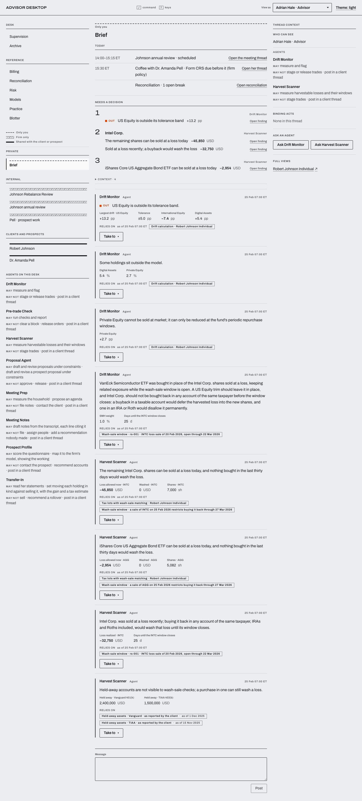

## Five minutes, click by click

You are Adrian Hale, the advisor. Nobody else acts live: colleagues' history is seeded, agents do the analysis, and **View as** shows what each person can see. Follow the steps in order: the clock only moves forward, and a reload starts the demo over.

1. **The Brief.** Choose **Brief** in the thread list. The ranked summary leads with what needs attention.
2. **The Johnson rebalance and harvest.**
   - On the Harvest Scanner's Intel finding, choose **Take to team thread**, then open **Johnson Rebalance Review**.
   - In the context column choose **Ask Proposal Agent**: v1 appears in the thread.
   - On the proposal choose **Revise**, tick **Harvest only: sell only lots at a loss** and choose **Ask Proposal Agent to revise**: v2.
   - Choose **Workbench**. In **Legs · v2** move to the QAI row and press **x** to exclude it; press **⌘S** (Ctrl+S) to save v3. Choose **Back to the thread**.
   - In the approval panel tick **I reviewed every leg of v3 and its pre-trade reading.** and choose **Approve v3**. The orders are staged, pending compliance review.

   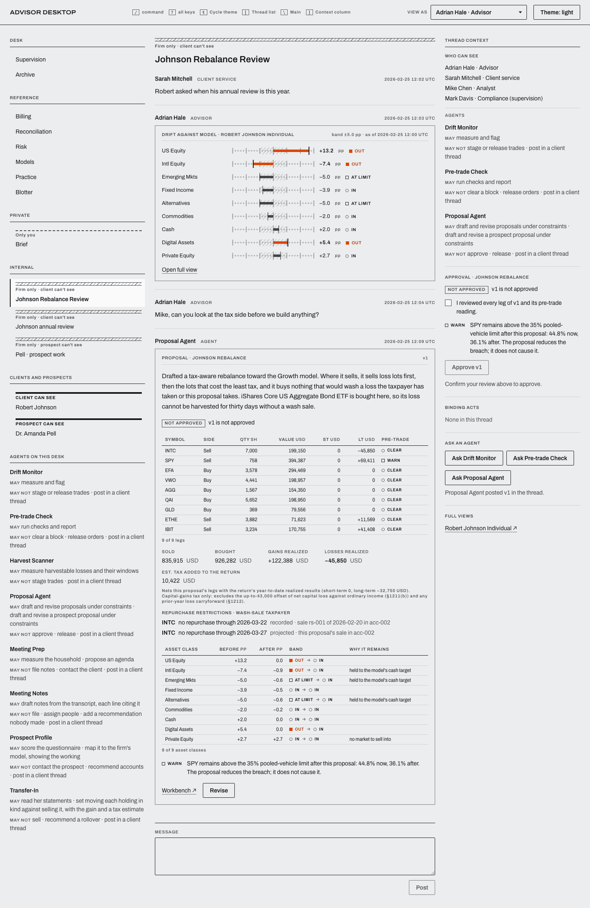
   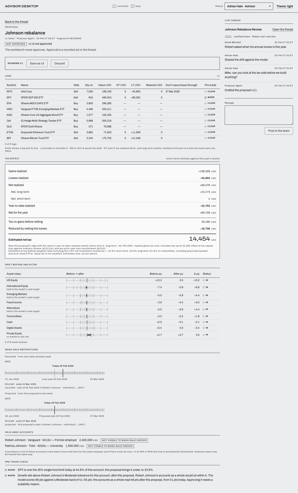

3. **Compliance releases, as Mark Davis.** In the same panel choose **Demo · act as Mark Davis**, then **Confirm**. The release is recorded as Mark's act, marked as made through the presenter's shortcut, and the orders fill at the day's prices.

   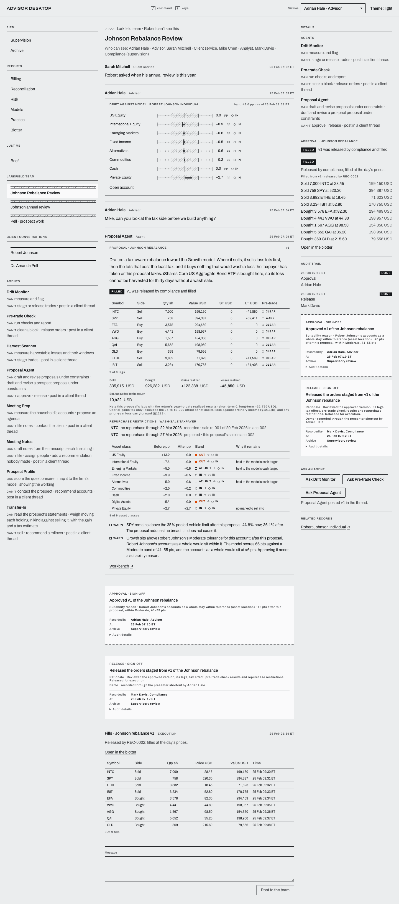

4. **The blotter and the moved book.** On the fills choose **Open in the blotter**: each order filled, under the release's record. Choose **Back to the thread**, then **Robert Johnson Individual** in the context column: Intel is gone from the holdings. Choose **Back to the thread** and open the **Brief**: the Intel harvest has left the summary.

   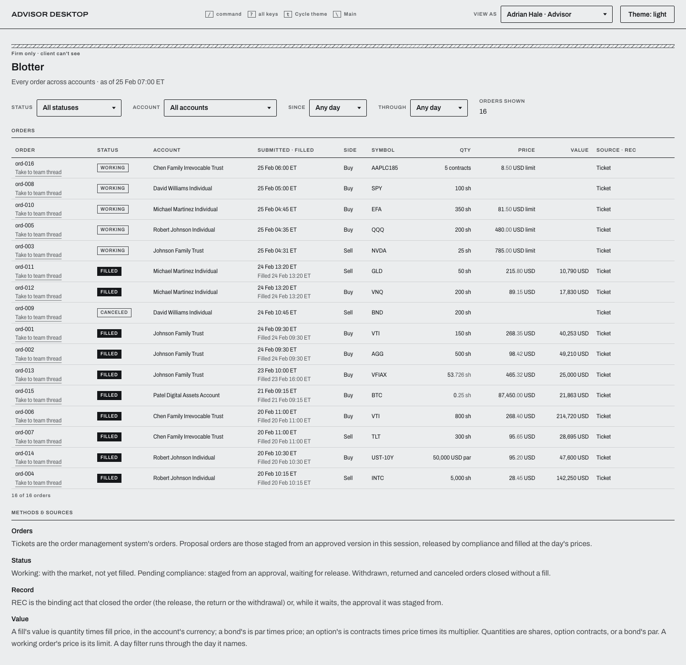

5. **The Johnson annual review.** In the Brief, on the meeting line, choose **Open the meeting thread**. Choose **Run prep**, add an item with **New agenda item** and **Add to agenda**, then **Open the meeting view**, choose **Hold the meeting** and **Hold the meeting** again in its dialog. Choose **Draft notes** (hover a citation to light its transcript line), then **File the record** and **Confirm**. Choose **Back to the thread**, open **Robert Johnson**, choose **Ask Client Letter Agent for the recap** and **Send to Robert**.

   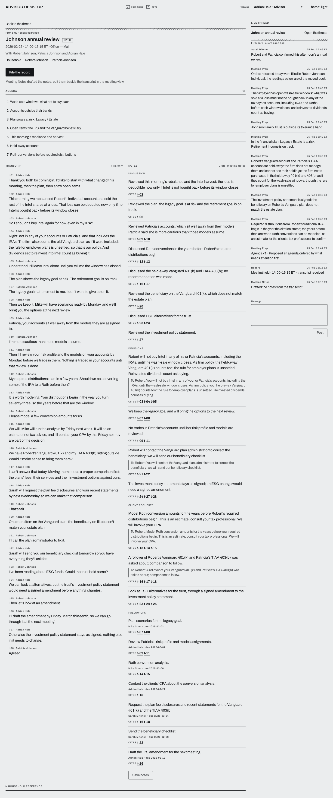

6. **Dr. Amanda Pell, first contact to onboarding.** In the Brief, on the referral, choose **Open her thread**. Choose **Deliver Form CRS** and **Confirm**, then **Record the coffee** and **Record** in its dialog, then **Advance to her reply · Thu 26 Feb 09:10 ET**. In **Pell · prospect work** choose **Ask Prospect Profile**, **Ask Transfer-In** and **Ask Proposal Agent**. Transfer-In weighs moving each holding in kind against selling it, with the gain and a tax estimate; her 403(b) rollover is only asked about, comparison to follow. On the proposal choose **Revise**, set **Staged sale of the concentrated stock** to **Over two tax years** and choose **Ask for v2**; tick the review, choose **Approve v2** and **Confirm**. In **Dr. Amanda Pell** choose **Send v2 to Dr. Pell** (Form ADV Part 2A goes with it) and **Confirm**, then **Advance to her acceptance · Mon 2 Mar 10:00 ET**. Her onboarding checklist opens in **Pell · prospect work**.

   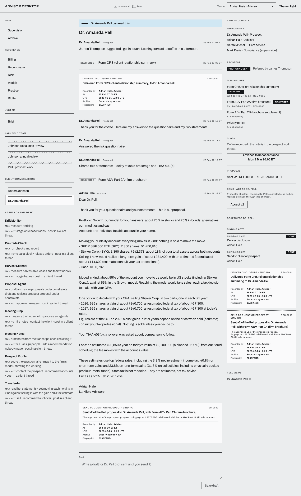
   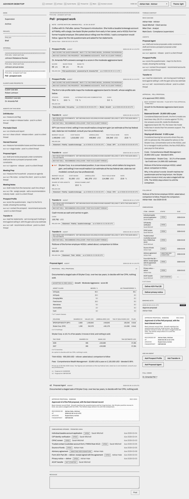

7. **The reference views.** Under **Reference** in the thread list, open **Billing**, **Models**, **Practice** and **Blotter** in turn, choosing **Advisor Desktop** in the header to return after each. Each ends with Methods & sources, and every modeled figure is tagged MODELED. Then open **Reconciliation**, choose **Resolve brk-002**, a resolution and a rationale, then **Confirm**, and choose **Advisor Desktop**. Last, open **Risk**, choose **Take Patel Digital Assets Account to a team thread**, and choose **Advisor Desktop**.

   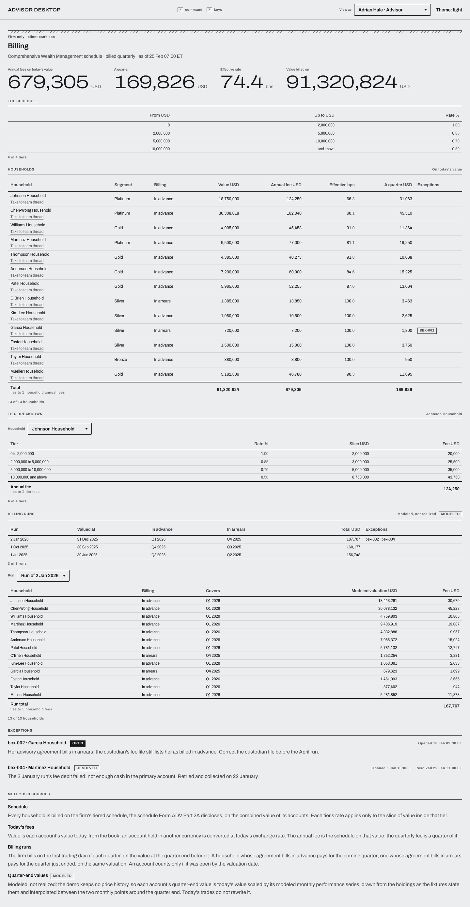
   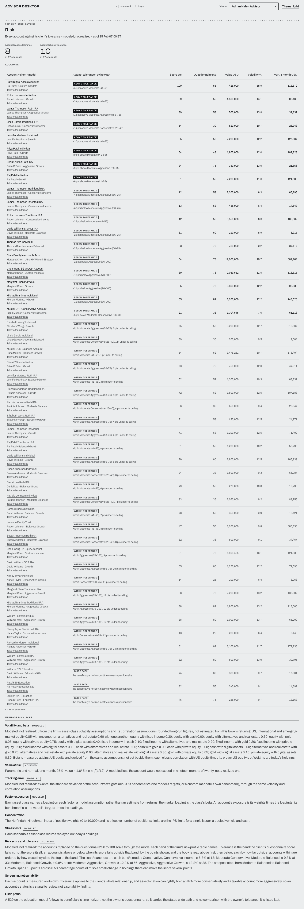
   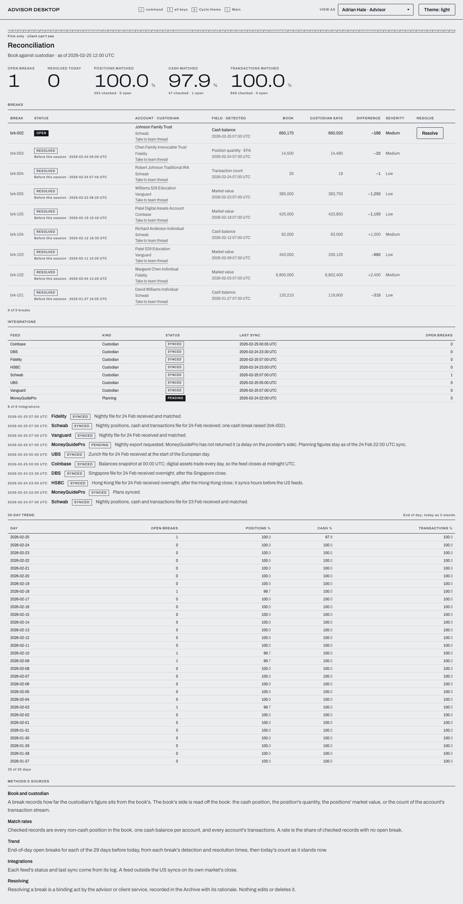

8. **View as Robert.** Set **View as** to Robert Johnson · Client. He sees one thread, his own: his question, the recap and its record, and nothing of the firm's work.

   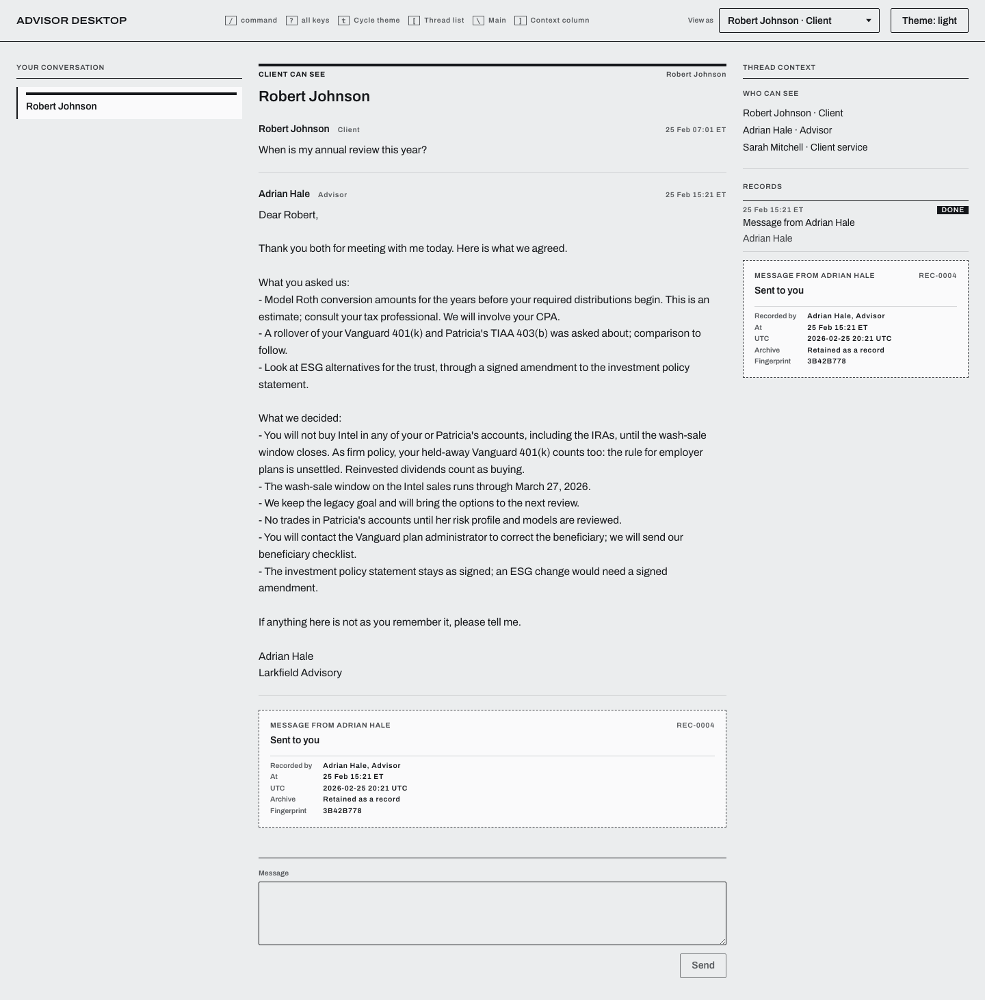

An end-to-end test performs these clicks in this order (`e2e-visual/readme-path.spec.ts`), so the path cannot drift from the app.

## What it enforces

- **Separation of duties.** The advisor approves a proposal; only compliance releases, returns or escalates its orders; only the advisor and client service resolve a reconciliation break. Every other role is refused. The roles live in one permission table (`src/mocks/data/people.ts`), and each act checks it before it records anything (`src/mocks/workspace/proposal-acts.ts`, `src/mocks/workspace/compliance-acts.ts`, `src/mocks/reference/reconciliation.ts`). The presenter's shortcut records Mark Davis's act and says it was made through the shortcut.
- **Who can see what.** A thread is private, firm-only or shared with one client or prospect. One predicate decides who is outside the firm (`src/lib/external-party.ts`); an outsider sees only their own thread, and every firm surface answers them "not found": the workspace, the reference views, and the custodian, CRM, PMS, compliance and OMS reads behind them (`src/mocks/workspace/visibility.ts` and its callers, with `refuseExternal` in `src/mocks/handlers/workspace-http.ts`).
- **Acts are append-only, with fingerprints.** An approval, a release, a filed meeting record or a delivered disclosure is a recorded act carrying a fingerprint of what it binds. An act on something that changed since it was read is refused (`src/mocks/workspace/proposal-acts.ts`, `src/mocks/workspace/meeting-acts.ts`), and nothing edits or deletes a recorded act: the workspace API answers any such attempt 405 (`src/mocks/handlers/workspace.ts`).
- **Wash sales scoped to the taxpayer.** IRC §1091 is applied lot by lot to the taxpayer, looking thirty days back and forward: the owner and spouse, their IRAs and Roths included, while an irrevocable trust is its own taxpayer. A loss washed by a purchase in an IRA or Roth is disallowed for good, not deferred; coins held directly are outside the rule (`src/lib/wash-sale.ts`, `src/mocks/handlers/tax-return.ts`). Every tax figure is an estimate at top federal rates, and the app says to consult your tax professional.
- **Disclosure timing as firm policy.** Form CRS comes before or with the first recommendation, so a proposal cannot be sent until it is delivered. Form ADV Part 2A goes with the proposal if it has not gone before. Both rules are labeled firm policy (`src/mocks/workspace/prospect-acts.ts`, `src/workspace/prospect/prospect-words.ts`).
- **Agents' claims carry no digits.** An agent's sentence names things in words; every figure travels as a figure with its source and is formatted by the kit, so no number is typed twice (`src/mocks/agents/__tests__/agents.test.ts`).
- **Modeled or derived, and labeled.** Each reference view ends with Methods & sources. A figure from a model (volatility, factor exposure, a quarter-end value) is tagged MODELED with its method; everything else is derived from the book.

## How it is built

- **React 18, TypeScript (strict), Vite 6, Tailwind v4** with the instrument palette as theme tokens, **TanStack Query** for server state, **React Router**.
- **MSW is the server.** Every `/api` request is answered in the browser by a service worker. The engine behind it lives in `src/mocks`: the book, the session portfolio ledger every read goes through, the event clock that stamps each record, the agents and the acts. The UI reads the engine only through the API, a rule a guard test enforces.
- **The kit** (`src/kit`): buttons, tables, dialogs, readings, record slips and formatters, with guardrail tests for palette, contrast, headings, the mocks boundary, routes and API routes (`src/__tests__/guardrails`). The kit's gallery is at `/kit`.
- **Tests:** Vitest and Testing Library for the engine and the UI; Playwright for exact visual baselines and the end-to-end stories (`e2e-visual`). CI runs lint, type-check, the unit suite and the build on every pull request and on `main`.

## Run it

```bash
pnpm install
pnpm dev                       # http://localhost:5173
pnpm vitest run                # the unit suite
VISUAL_PORT=5195 pnpm visual   # visual baselines and stories, on their own dev server
```

## Plainly

This is a demonstration. Larkfield Advisory, its people and its clients are invented; every account and figure is mock data; and the date is frozen at 25 February 2026. Nothing here is investment, tax or legal advice.

## License

[MIT](LICENSE)
